<picture>
  <source media="(prefers-color-scheme: dark)" srcset="assets/hero-dark.svg">
  <source media="(prefers-color-scheme: light)" srcset="assets/hero-light.svg">
  
</picture>

Ich schreibe Laravel-Code und löte danach ESP32-Boards. Ich betreibe einen eigenen Server, weil meine Daten bei mir bleiben sollen.
Ich lerne durch Machen: erst bauen, dann kaputtmachen, dann verstehen, warum.

<picture>
  <source media="(prefers-color-scheme: dark)" srcset="assets/orbit-dark.svg">
  <source media="(prefers-color-scheme: light)" srcset="assets/orbit-light.svg">
  
</picture>

## Beweisstücke

<table>
<tr>
<td width="50%" valign="top">

**Homeserver-Dashboard**
*privat, läuft bei mir zu Hause*

Zwölf Apps für Geld, Licht, Serien und Aufgaben. Jetzt eine Oberfläche auf einem Server, ohne Cloud-Zwang. Läuft auf meinem Server. Meistens.

`Laravel` `Livewire` `Docker` `Ansible`

</td>
<td width="50%" valign="top">

**Lokale KI und Agenten-Pipeline**
*privat, läuft bei mir zu Hause*

Externe API, fremde Server, fremde Rechnung? Stattdessen ein eigenes Modell und eine Loop-Pipeline, die Aufgaben als PRD abarbeitet, während ich schlafe.

`Python` `FastAPI` `aider`

</td>
</tr>
<tr>
<td valign="top">

**Auto-Wartungs-Tracker**
*privat, in Arbeit*

Den Ölwechsel vergisst man. Ein ESP32 mit GPS zählt Fahrten, erinnert rechtzeitig und synct mit meinem Dashboard. Verlötet, bevor es jemand verbieten kann.

`ESP32` `GPS` `Laravel`

</td>
<td valign="top">

**Kleiderschrank-PWA**
*privat, läuft bei mir zu Hause*

Voller Schrank, nichts anzuziehen. Jetzt ist der Schrank digital und das Problem nur noch halb so groß.

`Laravel` `Livewire` `PWA`

</td>
</tr>
</table>

Öffentlich, und ehrlich ganz am Anfang: [ErstesProjektCs2stats](https://github.com/GigaOaxl/ErstesProjektCs2stats) (PHP) und [ChessLf10a](https://github.com/GigaOaxl/ChessLf10a) (C).

## Werkzeug

**Software** PHP 8.3 · Laravel · Livewire · Python · FastAPI · Alpine.js · Bootstrap · Sass · Vite
**Betrieb** Linux · Docker Compose · nginx · Ansible · WireGuard · MQTT
**Hardware** ESP32 · Löten · PC-Umbauten, auch mit nur drei funktionierenden RAM-Slots

<picture>
  <source media="(prefers-color-scheme: dark)" srcset="https://raw.githubusercontent.com/GigaOaxl/GigaOaxl/output/github-snake-dark.svg">
  <source media="(prefers-color-scheme: light)" srcset="https://raw.githubusercontent.com/GigaOaxl/GigaOaxl/output/github-snake.svg">
  
</picture>

Kontakt: folgt. Erreichbar bin ich vorerst über GitHub.

